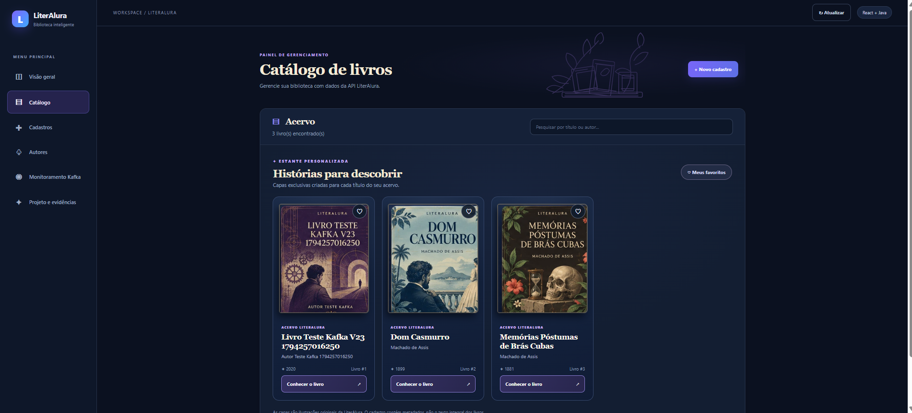
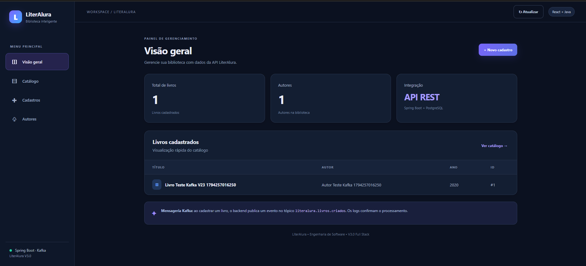
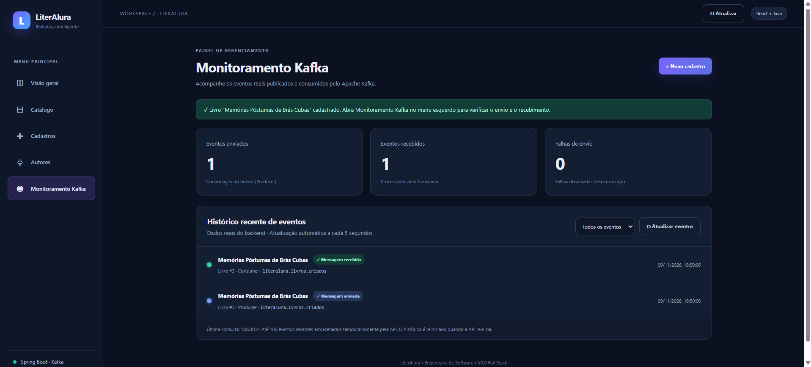
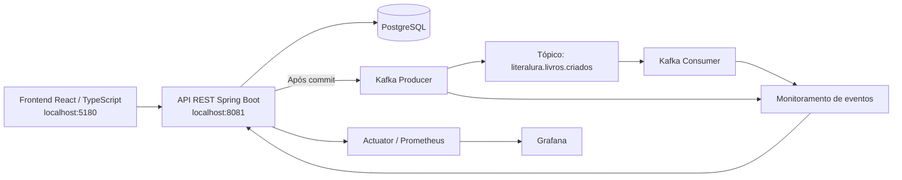

# 📚 LiterAlura — Engenharia de Software Full Stack


**Catálogo de autores e livros com API REST Java, frontend React, persistência PostgreSQL, eventos assíncronos Kafka e observabilidade.**

**Versão V3.0:** interface e integração validadas localmente; publicação no GitHub em preparação via Pull Request. A versão consolidada na `main` permanece V2.3 até o merge.

**Destaques:** catálogo ilustrado com capas próprias, cadastro de livros e autores, Kafka Producer/Consumer, monitoramento em tempo real e documentação para portfólio.


## 🖼️ Interface real — catálogo ilustrado V3.0



*Captura real da aplicação React executada localmente em 09/11/2026. As capas são ilustrações próprias, não imagens de edições comerciais. O primeiro item é um livro de teste do fluxo Kafka.*

## 🔎 Outras evidências da V3.0

| Visão geral | Monitoramento Kafka |
|---|---|
|  |  |

[Cadastro de livro](docs/evidencias/literalura-v3/02-cadastro-livro.png) ·
[PR V2.3 integrado](docs/evidencias/literalura-v3/04-pr-v23-merge.png) ·
[Documentação STAR e evidências](docs/LITERALURA_V30_STAR_EVIDENCIAS.md)

> As imagens são capturas do ambiente local. O frontend V3.0 ainda **não possui URL pública**; `localhost:5180` funciona somente no computador que executa o projeto.

## 🎯 Funcionalidades

- Cadastro e listagem de **autores** e **livros** por API REST, com persistência em PostgreSQL.
- Interface React + TypeScript + Vite com **Visão geral**, **Catálogo**, **Cadastros**, **Autores**, **Monitoramento Kafka** e **Projeto e evidências**.
- Persistência no **PostgreSQL 17** com Spring Data JPA/Hibernate.
- Após o commit do cadastro de um livro, publicação de `LivroCriadoEvent` no tópico Kafka `literalura.livros.criados`.
- Consumer Kafka registra o processamento dos eventos.
- Monitoramento visual de eventos **publicados, recebidos e falhas observadas**, com atualização a cada 5 segundos.
- Observabilidade com Spring Boot Actuator, Prometheus, Grafana e logs JSON com Request ID.
- Testes automatizados e integração contínua no GitHub Actions.

## 🧩 Arquitetura



**Importante:** o monitoramento armazena até **100 eventos recentes em memória**. Os contadores e o histórico visual reiniciam com a API; isso **não** implica perda das mensagens armazenadas no Kafka. O monitoramento de eventos é uma funcionalidade de demonstração local, não uma solução de auditoria persistente.

## 🛠️ Tecnologias

| Camada | Tecnologias |
|---|---|
| Frontend | React, TypeScript, Vite, CSS |
| Backend | Java 17, Spring Boot 3.2.5, REST, JPA/Hibernate |
| Dados | PostgreSQL 17; H2 nos testes |
| Mensageria | Spring Kafka, Apache Kafka 3.9.1 (KRaft) |
| Observabilidade | Spring Boot Actuator, Prometheus, Grafana, JSON logs |
| Qualidade | JUnit 5, Mockito, Maven, GitHub Actions |
| Infraestrutura | Docker, Docker Compose |

## ▶️ Como executar localmente

**Pré-requisitos:** Docker Desktop em execução, Node.js compatível com o Vite e npm.

1. Clone o repositório e acesse a pasta do projeto.
2. Crie `.env.sicredi` na raiz, com `LITERALURA_DB_PASSWORD` definido. **Esse arquivo é local e não deve ser enviado ao GitHub.**
3. Inicie a API, banco, Kafka e observabilidade:

```powershell
docker compose --env-file .env.sicredi `
  -f compose.sicredi.yaml `
  -f compose.observabilidade.yaml `
  -f compose.kafka.yaml up -d --build
```

4. Inicie o frontend em outro terminal:

```powershell
cd frontend
npm ci
npm run dev
```

**Endereços locais**

| Serviço | Endereço |
|---|---|
| Aplicação React | http://127.0.0.1:5180 |
| API Spring Boot | http://127.0.0.1:8081 |
| Swagger UI | http://127.0.0.1:8081/swagger-ui/index.html |
| Health | http://127.0.0.1:8081/actuator/health |
| Grafana | http://127.0.0.1:3002 |
| Prometheus | http://127.0.0.1:9091 |

O proxy de desenvolvimento do Vite encaminha requisições `/api/*` para a API Java na porta `8081`. O acesso ao Kafka pelo host, quando necessário, é `localhost:19094`.

**Observação para instalações novas:** no ambiente Windows/Docker utilizado, o volume do Kafka precisou ter a propriedade de `/tmp/kraft-combined-logs` ajustada para o usuário `1000:1000`. Consulte [o guia Kafka V2.3](docs/LITERALURA_V23_KAFKA.md) e os logs do contêiner caso o broker reinicie por erro de permissão. Não use `docker compose down -v` para tentar corrigir isso: esse comando pode excluir dados persistidos.

## 🧪 Testes e CI

```powershell
# API Java e testes automatizados
docker run --rm -v "${PWD}:/workspace" -w /workspace `
  maven:3.9-eclipse-temurin-17 mvn -B --no-transfer-progress clean verify

# Build do frontend
cd frontend
npm ci
npm run build
```

- **V2.3:** 11 testes Java aprovados, sem falhas; publicação e consumo de eventos Kafka validados em ambiente local.
- **V3.0:** frontend integrado à API; cadastro e monitoramento visual de um livro verificados em ambiente local. A suíte final da V3.0 deve ser novamente executada no Pull Request.
- [Execuções de integração contínua no GitHub Actions](https://github.com/Rogerio5/literalura-one-challenge-Springboot-Java/actions).
- Workflow de frontend preparado em `.github/workflows/frontend-ci.yml` (compilação com Node 24 em Pull Requests e pushes relevantes). A aprovação dependerá da execução do GitHub Actions.

## 🧭 Evolução do projeto

| Versão | Entrega |
|---|---|
| V2.0 | API Java, PostgreSQL, Docker e CI |
| V2.1 | Prometheus, Grafana e Actuator |
| V2.2 | Logs estruturados e Request ID |
| V2.3 | Kafka Producer/Consumer e eventos após commit |
| V3.0 | Frontend React + monitoramento visual + catálogo ilustrado + documentação STAR e evidências |


<!-- LITERALURA-V30-CATALOGO-ILUSTRADO -->
## 🎨 Catálogo ilustrado — LiterAlura V3.0

O catálogo exibe **capas originais ilustradas** para *Dom Casmurro* e *Memórias Póstumas de Brás Cubas*, de Machado de Assis. Novos títulos podem usar capas geradas pela identidade visual da plataforma. A busca filtra livros por título ou autor; há **favoritos locais** e um painel para conhecer os dados de cada obra.


A [imagem de conceito](docs/evidencias/literalura-v3/06-referencia-visual-gerada.png) foi usada como referência de design, enquanto a captura acima é a **evidência do aplicativo em execução**.

[Documentação do catálogo ilustrado](docs/LITERALURA_V30_CATALOGO_ILUSTRADO.md).

> **Escopo:** o projeto gerencia metadados bibliográficos e pode oferecer uma busca externa por edições digitais. **Não oferece ainda a leitura integral dos livros dentro do sistema.**

## ⭐ Método STAR

**S — Situação:** transformar um catálogo Java em um estudo de Engenharia de Software com integração, rastreabilidade e mensageria.

**T — Tarefa:** integrar persistência, comunicação assíncrona, observabilidade e uma interface de uso simples, preservando os testes existentes.

**A — Ação:** evoluir o projeto por versões com Spring Boot, PostgreSQL, Kafka, Docker, Prometheus, Grafana e React/TypeScript, registrando evidências de cada etapa.

**R — Resultado:** 11 testes Java aprovados na V2.3; fluxo de cadastro real validado de ponta a ponta; monitoramento visual mostrando **1 envio, 1 recebimento e 0 falhas observadas** para o livro de demonstração.

Detalhes e capturas: [Documentação STAR V3.0](docs/LITERALURA_V30_STAR_EVIDENCIAS.md).

## 📁 Estrutura principal

```text
├── frontend/                         # React + TypeScript + Vite
│   └── public/evidencias/            # Imagens exibidas na interface
├── src/main/java/br/com/literalura/
│   ├── controller/                    # API REST e monitoramento Kafka
│   ├── kafka/                         # Producer, Consumer, eventos e serviço
│   ├── model/                         # Entidades JPA
│   ├── repository/                    # Repositórios
│   └── service/                       # Regras de negócio
├── src/test/                          # Testes Java
├── monitoring/                        # Prometheus/Grafana
├── docs/                              # Documentação técnica
│   └── evidencias/literalura-v3/     # Capturas reais
├── compose.sicredi.yaml
├── compose.observabilidade.yaml
├── compose.kafka.yaml
└── .github/workflows/                # Integração contínua
```

## ⚠️ Limitações e próximos passos

- Histórico do monitoramento Kafka **não persistente**; para auditoria real seria necessária persistência apropriada.
- A publicação após commit não equivale a entrega garantida diante de toda falha distribuída; uma evolução possível é **Transactional Outbox**.
- O ambiente apresentado é **local**, sem deploy público da V3.0.
- Antes de uso em produção, revisar segurança, credenciais, resiliência e política de tratamento de eventos.

## 👨‍💻 Autor e licença

Desenvolvimento e evolução do projeto: [Rogerio5 no GitHub](https://github.com/Rogerio5).

Projeto originalmente desenvolvido como desafio de aprendizado LiterAlura. Licença: [MIT](LICENSE).
